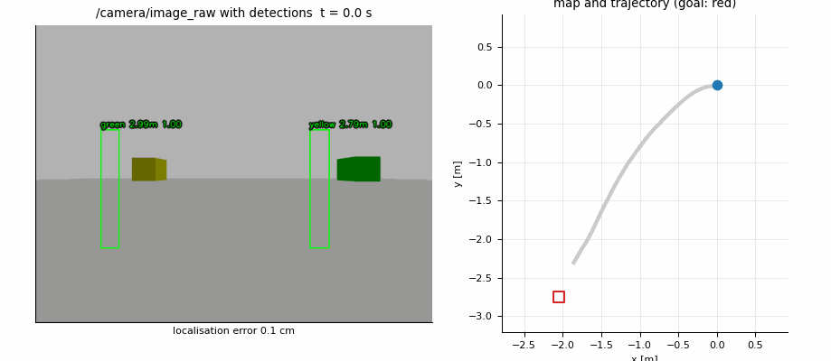
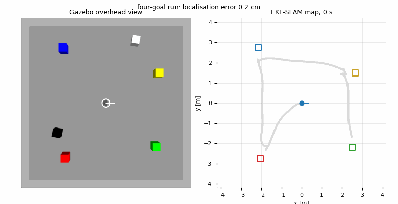
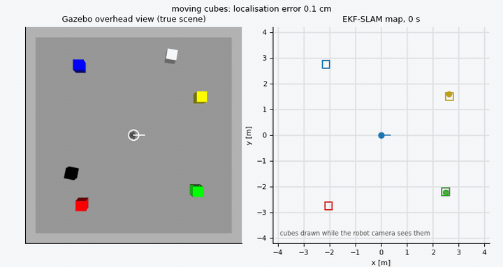
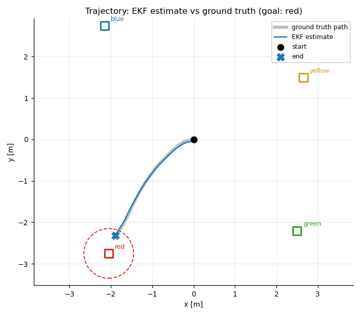
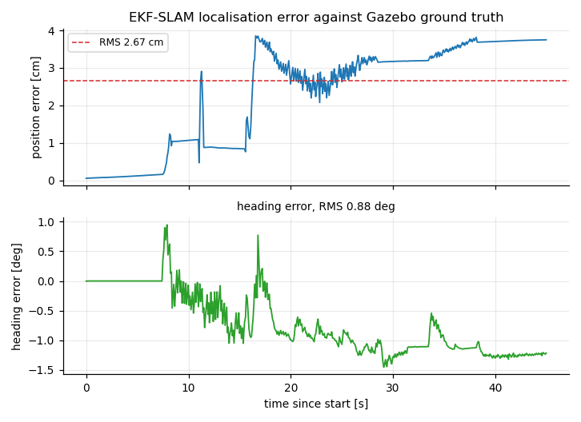

<p align="center">
  <a href="README.md">English</a> | <a href="README.zh-CN.md">简体中文</a>
</p>

# BEACON

[](https://github.com/Zhuqiben/beacon/actions/workflows/ci.yml)
[](LICENSE)
[](https://docs.ros.org/en/humble/)
[](https://classic.gazebosim.org/)

项目名 BEACON 取自 **B**earing-based **E**stimation、**A**ctive **C**olour landmark h**O**ming
与 **N**avigation。

这是一套 ROS 2（Humble）仿真系统：TurtleBot 3 Waffle 在 Gazebo 场地中探索，用深度相机识别
彩色地标方块，通过 EKF-SLAM 滤波器建立地标地图，随后自行行驶到指定颜色处，途中避开两个游走的
黑白方块。

全部内容运行在单机上，不依赖任何硬件：机器人、相机、传感器噪声和移动障碍物都存在于仿真之中，
用于评分的真值也直接来自 Gazebo。

## 目录

* [系统做什么](#系统做什么)
* [实测结果](#实测结果)
* [软件包](#软件包)
* [环境要求](#环境要求)
* [构建](#构建)
* [运行](#运行)
* [接口](#接口)
* [工具](#工具)
* [参数](#参数)
* [测试](#测试)
* [设计说明](#设计说明)
* [参与贡献](#参与贡献)
* [引用](#引用)
* [许可证](#许可证)

## 系统做什么

一个 `GoToBlock` 目标指定一种颜色（`red`、`green`、`blue` 或 `yellow`）。动作服务器随后走一个
很小的状态机：

| 状态 | 行为 |
|---|---|
| `SEARCHING` | 旋转、缓行，直到目标颜色被足够可靠地观测到。 |
| `NAVIGATING` | 把估计出的地标位置交给 Nav2 的 `navigate_to_pose` 动作，行驶过去。 |
| `APPROACHING` | 用一段缓慢的最后蠕行收掉最后一段距离，到达指定间距。 |
| `DONE` / `ABORTED` | 报告实际到达的间距，或说明目标失败的原因。 |

目标执行期间，服务器会持续把相机看到的场景与地图对齐，因此一个实际位置与地图不符的地标不会一直
拖着计划走下去。

## 实测结果



8 次带种子的任务，覆盖 5 个世界种子与全部 4 种目标颜色，每一次都到达了目标。

| 运行 | 目标 | 耗时 | 末距 | 路径长度 | 观测数 | 定位 RMS | 地标图误差 |
|---|---|---|---|---|---|---|---|
| `s1490_red` | 红 | 36.3 s | 0.554 m | 3.06 m | 636 | 2.7 cm | 9.5 cm |
| `s1490_green` | 绿 | 16.9 s | 0.550 m | 2.87 m | 265 | 7.2 cm | 6.7 cm |
| `s1490_blue` | 蓝 | 26.8 s | 0.547 m | 3.10 m | 434 | 3.6 cm | 8.7 cm |
| `s1490_yellow` | 黄 | 19.3 s | 0.550 m | 2.55 m | 275 | 4.5 cm | 6.8 cm |
| `s3141_red` | 红 | 30.4 s | 0.545 m | 2.89 m | 577 | 7.8 cm | 7.2 cm |
| `s42_yellow` | 黄 | 15.3 s | 0.550 m | 1.61 m | 274 | 6.2 cm | 3.4 cm |
| `s777_green` | 绿 | 17.6 s | 0.552 m | 2.68 m | 427 | 2.6 cm | 11.5 cm |
| `s7_blue` | 蓝 | 24.3 s | 0.549 m | 2.41 m | 540 | 2.5 cm | 11.2 cm |
| **均值** | | **23.4 s** | **0.550 m** | **2.65 m** | **428** | **4.6 cm** | **8.1 cm** |

末距稳定在 0.55 m，是因为目标选择器一旦进入 0.60 m 接近半径就停车，所以这一列衡量的是地标定位
得准不准，而不是车能开多近。



四个目标也能在同一次启动、同一张地图上连着跑完：红、蓝、黄、绿全部到达。这一次在 204 s 内行驶
16.8 m，定位 RMS 6.0 cm，最差的一段也停在离色块 0.59 m 处。左栏是从正上方俯视世界的相机，
右栏是滤波器相信的地图，两栏可以逐帧对照。



把两个方块开起来再跑一遍，结果没有变化：4/4 全部到达，212 s 行驶 17.1 m，定位 RMS 6.5 cm，
全程没有碰到方块或色块。左栏里白色与黑色方块逐帧平移，机器人在场地里绕行；右栏里方块只有在
机器人相机报告它时才会画出，地图因此不会假装知道看不见的障碍在哪里。





其余内容在 [docs/media/README.zh-CN.md](docs/media/README.zh-CN.md)：各阶段耗时与观测速率曲线、
8 次运行的横向对比、另外两段动画、上面每一个数字背后的原始日志，以及录制方式。

## 软件包

| 软件包 | 作用 |
|---|---|
| `slam_interfaces` | `Landmark`、`LandmarkArray`、`LandmarkMap` 消息，`GoToBlock` 动作与 `StartObstacles` 服务。 |
| `landmark_detector` | 生命周期节点：同步的 RGB-D 输入、HSV 阈值分割、逐方块的距离与方位。另附颜色标定工具。 |
| `ekf_slam` | 纯 numpy 的 EKF-SLAM 核心及其 ROS 节点。里程计预测、带卡方门限的地标更新、`map->odom` TF。 |
| `landmark_map` | 把地标估计转换成带逐地标膨胀的锁存 `OccupancyGrid`。 |
| `goal_selector` | `GoToBlock` 动作服务器、其后的状态机，以及机器人对地标的碰撞记录。 |
| `performance_monitor` | 流水线延迟与定位误差指标，发布在 `/performance_monitor`。 |
| `visualizer` | 带标注的相机画面，以及估计地图的 RViz 标记。 |
| `sim_bringup` | 启动文件、世界文件、模型、参数，以及下面列出的命令行工具。 |
| `client_node` | 交互式 / 可脚本化的 `GoToBlock` 客户端。 |

## 环境要求

x86_64 上的 Ubuntu 22.04（Jammy），搭配 ROS 2 Humble 与 Gazebo Classic 11：

* ROS 2 Humble（`ros-humble-desktop`）
* Gazebo Classic 11 及其 `gazebo_ros`
* `turtlebot3_gazebo` 与 `turtlebot3_description`（Waffle 模型及其差速驱动插件）
* Nav2，含 `nav2_collision_monitor`
* `python3-numpy`、`python3-scipy`、`python3-opencv`、`cv_bridge`、`xacro`

这些都由一个幂等脚本一次装好：

```bash
git clone https://github.com/Zhuqiben/beacon.git ~/ros2_ws
cd ~/ros2_ws
./scripts/install_deps.sh
```

[docs/INSTALL.zh-CN.md](docs/INSTALL.zh-CN.md) 列出了每个软件包、手动 `apt` 安装路线、ROS 2
apt 软件源的引导步骤，以及虚拟机环境里常见的坑。`./scripts/install_deps.sh --check` 只报告缺什么，
不改动机器。

## 构建

```bash
source /opt/ros/humble/setup.bash
cd ~/ros2_ws
colcon build --symlink-install
source install/setup.bash
```

请在包含 `src/` 的工作区根目录下执行，并先加载 ROS 2，否则 `colcon` 找不到 `sim_bringup` 与
`slam_interfaces` 所依赖的软件包。构建成功的最后一行是
`Summary: 9 packages finished [...]`；新开的终端要先 `source install/setup.bash`，否则看不到本
工作区的任何内容。

[docs/BUILD.zh-CN.md](docs/BUILD.zh-CN.md) 讲其余部分：每个软件包产出什么、为什么要
`--symlink-install`、哪些改动需要重新构建而哪些不需要、只构建单个软件包
（`--packages-up-to`）、什么时候该清空 `build/` 与 `install/`，以及实践中遇到的构建失败。
[docs/WALKTHROUGH.zh-CN.md](docs/WALKTHROUGH.zh-CN.md) 则把整条路径走一遍，从 clone 到目标
执行完成。

## 运行

带 Gazebo 图形界面的完整系统：

```bash
ros2 launch sim_bringup demo.launch.py
```

无界面（容器、CI）：

```bash
ros2 launch sim_bringup demo.launch.py gui:=false
```

然后在第二个终端下发一个颜色：

```bash
ros2 run client_node client --color red
```

`demo.launch.py` 接受若干参数，`ros2 launch sim_bringup demo.launch.py -s` 可以全部列出。比较
有用的是 `world`（加载哪个场景）、`spawn_x` / `spawn_y` / `spawn_yaw_deg` 这组出生位姿、
`min_landmarks`（一次 EKF 修正需要多少个有效地标更新）以及 `creep_topic`（最后蠕行的角速度
发到哪个话题）。

[docs/WALKTHROUGH.zh-CN.md](docs/WALKTHROUGH.zh-CN.md) 是从另一端看同一件事：从 `git clone` 到
`GoToBlock` 目标完成的编号步骤，每一步都给出可验证的结果。

### 随机场景

`m8_demo.launch.py` 按种子生成一个全新场地，在同一个软件栈上启动它，并驱动两个游走障碍物：

```bash
ros2 launch sim_bringup m8_demo.launch.py world_seed:=1490
```

种子决定地标摆放和两个方块的运动；同一个种子永远生成同一个场景。不指定 `world_seed` 时会随机
抽取一个并打印出来。加 `rviz:=true` 可以看 SLAM 地图视图，加 `gui:=false` 则为无界面运行。

## 接口

| 名称 | 类型 | 方向 |
|---|---|---|
| `goto_block` | `slam_interfaces/action/GoToBlock` | 动作，由 `goal_selector` 提供 |
| `~/start`、`~/set_enabled`、`~/reset` | `slam_interfaces/srv/StartObstacles`、`std_srvs/srv/SetBool`、`std_srvs/srv/Empty` | 服务，由 `dynamic_obstacles` 节点提供 |
| `/observations` | `slam_interfaces/msg/LandmarkArray` | 检测器 -> SLAM |
| `/landmark_map` | `slam_interfaces/msg/LandmarkMap` | SLAM -> 地图、可视化、目标选择 |
| `/robot_pose` | `geometry_msgs/msg/PoseWithCovarianceStamped` | SLAM 位姿估计 |
| `/map` | `nav_msgs/msg/OccupancyGrid` | 锁存，由 `landmark_map` 发布 |
| `/landmark_markers`、`/observations/annotated` | `visualization_msgs/msg/MarkerArray`、`sensor_msgs/msg/Image` | RViz / 调试 |
| `/performance_monitor`、`/performance_report` | `std_msgs/msg/Float32MultiArray`、`std_msgs/msg/String` | 指标 |
| `/reset_slam` | `std_srvs/srv/Empty` | 清空滤波器并重新初始化地图 |

## 工具

```bash
ros2 run sim_bringup world_setup.py        # 执行一次随机化；写出世界文件
ros2 run sim_bringup world_rules.py        # 摆放与游走规则本身
ros2 run sim_bringup dynamic_obstacles.py  # 驱动两个方块
ros2 run sim_bringup benchmark.py          # 对照 /gazebo/model_states 真值计算指标
ros2 run sim_bringup visibility_map.py     # 场地中哪些位置能看到多少个地标
ros2 run sim_bringup tf_relay.py           # /tf 新鲜度中继
ros2 run landmark_detector sample_color    # 点取像素，打印可直接粘贴的 HSV 阈值
```

`sim_bringup` 的这些工具由 `install(PROGRAMS ...)` 直接从 `scripts/` 安装，因此保留 `.py`
后缀；`sample_color` 是 console script，没有后缀。`ros2 pkg executables sim_bringup` 列出实际
安装的内容。

## 参数

| 文件 | 内容 |
|---|---|
| `sim_bringup/config/params.yaml` | 检测器阈值、EKF 噪声与门限、地图膨胀、障碍物速度。 |
| `sim_bringup/config/nav2_params.yaml` | Nav2 控制器、规划器与碰撞监控配置。 |
| `ekf_slam/config/ekf_params.yaml` | 节点加载的滤波器默认值。 |
| `landmark_detector/config/detector_params.yaml` | 每种地标的颜色阈值。 |
| `landmark_map/config/map_params.yaml` | 栅格分辨率、范围与膨胀。 |
| `goal_selector/config/goal_selector_params.yaml` | 间距、超时与重试策略。 |

参数以扁平方式声明而非嵌套；启动文件与 `world_setup.py` 以 `key:=value` 形式覆盖它们。

## 测试

```bash
cd ~/ros2_ws
PYTEST_DISABLE_PLUGIN_AUTOLOAD=1 python3 -m pytest src -q
```

这些用例覆盖纯逻辑层（EKF 核心、坐标变换、颜色阈值、状态机与碰撞记录），因此无需 ROS 图，也无需
Gazebo。

持续集成在 ROS 2 Humble 上运行 flake8、shellcheck、清单与资源检查、一次完整的 `colcon build`
以及同一条测试命令。详见 [.github/workflows/ci.yml](.github/workflows/ci.yml)。

## 设计说明

* `nav2_navigation.launch.py` 是 Nav2 `navigation_launch.py` 的副本。原文件把 `velocity_smoother`
  的输出重映射到 `cmd_vel`，`collision_monitor` 因此落在控制链路之外；副本只改这一处映射，把它
  接回来。
* `tf_relay.py` 解决 `/tf` 的时延。Gazebo 的差速驱动插件发布 `odom->base_footprint` 并不匀速：
  常常静默数秒，再把积压的变换一次性补发，于是以 RELIABLE 方式订阅的一方拿到的是几秒前的
  `stamp`，而同一条消息的 BEST_EFFORT 副本始终新鲜。该节点把这条边重新发布一次，把 RELIABLE
  一侧的时延降到与 BEST_EFFORT 相当。

## 参与贡献

欢迎贡献。[CONTRIBUTING.md](CONTRIBUTING.md) 说明了开发环境、lint 与测试命令、注释风格，以及
如何提交 pull request。所有参与者都应遵守 [行为准则](CODE_OF_CONDUCT.md)。

问题报告与功能请求在 issue 区有对应模板。安全问题请走 [SECURITY.md](SECURITY.md) 描述的私下
流程，而不是公开 issue。每个版本的变更记录见 [CHANGELOG.md](CHANGELOG.md)。

## 引用

如果 BEACON 对你有学术帮助，请用 [CITATION.cff](CITATION.cff) 中的元数据引用；GitHub 的
"Cite this repository" 按钮读取的是同一个文件。

## 许可证

MIT，见 [LICENSE](LICENSE)。

有两个文件源自 Apache-2.0 内容并保留该许可证，详情与上游全文见
[THIRD_PARTY_NOTICES.md](THIRD_PARTY_NOTICES.md)。
