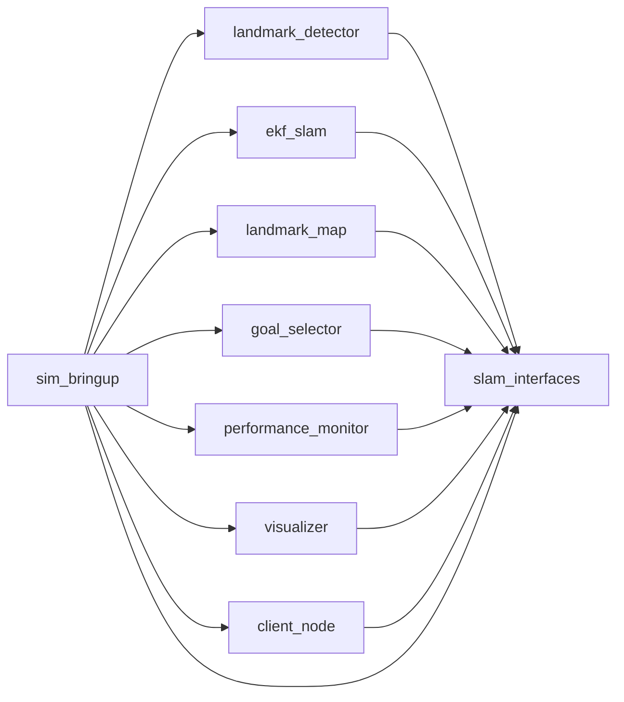

# Building BEACON

BEACON is an ordinary ROS 2 workspace: nine packages under `src/`, one `colcon build`, one
`source`. This page covers the build itself — what each package produces, which flags are
worth knowing, how to rebuild only the part you touched, and what to do when the build
fails. For installing Ubuntu, ROS 2 Humble and the dependencies, see
[INSTALL.md](INSTALL.md).

## Before the first build

The workspace only builds if ROS 2 and the system libraries are already on the machine.
Check that first:

```bash
source /opt/ros/humble/setup.bash
ros2 pkg prefix nav2_collision_monitor
gazebo --version
python3 -c 'import numpy, scipy, cv2'
```

If any of those fails, or `ros2` itself is not found, run `./scripts/install_deps.sh` and
read [INSTALL.md](INSTALL.md).

Two further things the build depends on:

* **A 3.10 `python3` on `PATH`.** Humble targets Python 3.10, and the workspace packages are
  installed into the same interpreter that builds them. A conda or virtual environment that
  shadows the system `python3` has to be deactivated first, or `ros2 run` will start a node
  against a different interpreter than the one that built it.
* **A filesystem with symbolic links.** `--symlink-install` needs real symlinks, so keep
  the workspace on a native Linux filesystem such as `~/ros2_ws`. A VirtualBox shared
  folder, an NTFS mount or a Windows path under WSL will break the build.

## The build

```bash
cd ~/ros2_ws
source /opt/ros/humble/setup.bash
colcon build --symlink-install
source install/setup.bash
```

`source /opt/ros/humble/setup.bash` is needed in every new shell **before** `colcon build`:
`colcon` looks up the ROS 2 packages that `slam_interfaces` and `sim_bringup` are built
against through the environment, not through a hard-coded path.

`colcon build` must be run from the workspace root — the directory that contains `src/`.
It finds the packages automatically and builds them in dependency order.

A successful build ends with:

```
Summary: 9 packages finished [1min 12s]
```

It is fast because almost nothing is compiled: message generation in `slam_interfaces` is
the only code generation step, and the seven Python packages are installed in editable
mode.

`build/`, `install/` and `log/` are generated in the workspace root. All three are
gitignored and disposable; nothing outside the workspace depends on them.

## What each package produces

| Package | Build type | What the build step does |
|---|---|---|
| `slam_interfaces` | `ament_cmake` | Runs `rosidl_generate_interfaces` to generate the C++ and Python bindings for the three messages, the `GoToBlock` action and the `StartObstacles` service. The only real compilation in the workspace. |
| `landmark_detector` | `ament_python` | Editable install of the package plus the `detector_node`, `lifecycle_autostart` and `sample_color` console scripts. |
| `ekf_slam` | `ament_python` | Editable install plus the `slam_node` script and `config/ekf_params.yaml`. |
| `landmark_map` | `ament_python` | Editable install plus the `map_node` script and `config/map_params.yaml`. |
| `goal_selector` | `ament_python` | Editable install plus the `action_server` script and `config/goal_selector_params.yaml`. |
| `performance_monitor` | `ament_python` | Editable install plus the `monitor_node` script. |
| `visualizer` | `ament_python` | Editable install plus the `viz_node` script. |
| `client_node` | `ament_python` | Editable install plus the `client` script. |
| `sim_bringup` | `ament_cmake` | Installs `launch/`, `worlds/`, `config/` and `models/` into `share/sim_bringup/`, and the six command line tools into `lib/sim_bringup/` so that `ros2 run sim_bringup <tool>` works. |

Everything a package needs at run time has to be listed in `install(...)` in its
`CMakeLists.txt` or in `data_files` in its `setup.py`. A file that is not installed is not
present after the build, even though it is in `src/`.

## Why `--symlink-install`

The flag makes the installed copies of the non-Python resources — launch files, worlds,
models, RViz configs, parameter files and the `sim_bringup` command line tools — symbol
links back into `src/` instead of copies. Editing a world file or a launch file then takes
effect on the next `ros2 launch` with no rebuild. The Python packages are editable either
way, so their source is what runs.

Without the flag those resources are copied, and editing one has no effect until the next
`colcon build`. Keep the flag on.

## Build order and dependencies

`colcon` derives the order from the `package.xml` declarations, so a plain `colcon build`
is always correct. The relationships inside the workspace are:



`sim_bringup` is the only package that pulls in the whole stack, because its launch files
start every node. `slam_interfaces` is the only package the others cannot do without.

### Changing an interface

Editing anything under `src/slam_interfaces/{msg,srv,action}/` means the generated bindings
change, and every package that imports them has to be rebuilt and re-sourced:

```bash
colcon build --symlink-install
source install/setup.bash
```

Do not rebuild only `slam_interfaces` in that case. A stale copy of the generated module is
the usual cause of an `ImportError` or an `AttributeError` on a field that "is clearly
there" in the `.msg` file.

## Rebuilding after an edit

| What changed | Command |
|---|---|
| A launch file, world, model, RViz config or parameter file | Nothing. `--symlink-install` already points at the source. |
| A Python file in a node or a CLI tool | Nothing, the packages are editable. Restart the node. |
| `package.xml` (a new dependency, a new export) | `colcon build --symlink-install` |
| `CMakeLists.txt`, `setup.py`, `entry_points`, new files | `colcon build --symlink-install` |
| Anything in `src/slam_interfaces/{msg,srv,action}/` | `colcon build --symlink-install` then `source install/setup.bash` |

## Building a subset

Useful while iterating, because a full build still costs about a minute.

```bash
# only this package, assuming its dependencies are already built
colcon build --symlink-install --packages-select ekf_slam

# this package and everything it needs
colcon build --symlink-install --packages-up-to sim_bringup

# this package and everything that depends on it
colcon build --symlink-install --packages-above slam_interfaces
```

After a subset build, source the workspace again. `install/setup.bash` is regenerated and
picks up whatever is present, so a subset build cannot corrupt the rest of the workspace —
but a package that was never built will simply not be importable, which is why
`--packages-up-to` is the safer default when in doubt.

## Flags worth knowing

| Flag | Effect |
|---|---|
| `--symlink-install` | Link resources instead of copying them. Use it always. |
| `--packages-select <pkg>` | Build only these packages. |
| `--packages-up-to <pkg>` | Build these packages plus their dependencies. |
| `--packages-above <pkg>` | Build these packages plus their dependents. |
| `--packages-skip <pkg>` | Exclude a package from the build. |
| `--parallel-workers N` | Limit how many packages are built at once. Rarely needed here. |
| `--continue-on-error` | Keep going after the first failing package, to see every failure at once. |
| `--event-handlers console_direct+` | Stream the raw build output instead of the filtered version. |
| `--cmake-args -DCMAKE_BUILD_TYPE=Release` | Optimise compiled code. Irrelevant for this workspace: only message generation is compiled. |

## When to wipe `build/` and `install/`

The three generated directories survive a lot, but a clean build is the right first
response to a handful of problems:

* the build fails with a message about a file that no longer exists in `src/`,
* `install/` contains a package or a version that `src/` no longer has,
* the workspace was copied from another machine, or built by a different user,
* a package name or a dependency in `package.xml` changed,
* the build succeeds but a node imports an old version of a module.

```bash
cd ~/ros2_ws
rm -rf build install log
source /opt/ros/humble/setup.bash
colcon build --symlink-install
source install/setup.bash
```

Deleting all three is always safe — they are gitignored and regenerated. `log/` in
particular grows by one `build_<timestamp>/` directory per build and can be deleted on its
own at any time.

If a previous build was run with `sudo`, `install/` ends up owned by root and the next
build fails with a permission error. Fix the ownership instead of escalating again:

```bash
sudo chown -R "$USER:$USER" build install log
```

## Checking the result

```bash
source install/setup.bash
colcon list                 # the nine packages and their paths
ros2 pkg prefix slam_interfaces
ros2 pkg executables sim_bringup
```

`ros2 pkg executables sim_bringup` should list `benchmark`, `dynamic_obstacles`, `tf_relay`,
`visibility_map`, `world_rules` and `world_setup`. If it is empty, the
`install(PROGRAMS ...)` step did not run — check that `scripts/` is present and that the
build actually completed.

## Running the tests

```bash
source /opt/ros/humble/setup.bash
source install/setup.bash
PYTEST_DISABLE_PLUGIN_AUTOLOAD=1 python3 -m pytest src -q
```

Sourcing `install/setup.bash` is what makes the workspace packages importable, so run the
suite after a build, not before. `PYTEST_DISABLE_PLUGIN_AUTOLOAD=1` keeps the pytest
plugins that `colcon build` installs — `launch_testing`, `ament_copyright`, `ament_flake8`
and `ament_pep257` — out of the run; they otherwise abort collection. CI uses exactly this
command, and the tests need no ROS graph, no Gazebo and no simulator. The four suites cover
the pure layers: the EKF core, the coordinate transforms, the colour thresholds and the goal
FSM with its collision ledger.

## Build settings, optionally

`--symlink-install` can be made the default so that `colcon build` alone is enough. Create
`~/.colcon/defaults.yaml`:

```yaml
build:
  symlink-install: true
```

The same file placed in the workspace root as `colcon_defaults.yaml` applies to that
workspace only and overrides the global one. BEACON does not ship either file, because both
change the behaviour of every `colcon` invocation on the machine and the flag is explicit
everywhere in the documentation.

## Continuous integration

[`.github/workflows/ci.yml`](../.github/workflows/ci.yml) builds and tests the workspace on
`ubuntu-22.04` with ROS 2 Humble. The relevant job runs:

```bash
source /opt/ros/humble/setup.bash
colcon build --symlink-install
source install/setup.bash
PYTEST_DISABLE_PLUGIN_AUTOLOAD=1 python3 -m pytest src -q
```

so a local build that follows this page reproduces CI. Two other jobs run `flake8` over
`src/` and `.github/scripts/`, `shellcheck` over `scripts/`, and a metadata check that
validates every `package.xml`, every YAML and XML asset and the line endings.

## Build problems

**`colcon: command not found`.**
Install `python3-colcon-common-extensions` and source ROS 2 first:
`source /opt/ros/humble/setup.bash`.

**`Summary: 0 packages finished` and no error.**
`colcon` was not run from the workspace root, or `src/` is not where the packages are. Run
`colcon list` to see what it found. If the packages live somewhere else, pass
`--base-paths <dir>`.

**Creating symlinks fails, or the build reports `Operation not supported`.**
The workspace is not on a filesystem with symlink support. Move it to a native Linux path,
or drop `--symlink-install` and accept a rebuild after every resource edit.

**`Package 'slam_interfaces' not found`, or the message types do not import.**
Either `slam_interfaces` has not been built, or `install/setup.bash` was not sourced in
this shell. Both `source /opt/ros/humble/setup.bash` and `source install/setup.bash` are
needed, in that order.

**A rebuild fails inside `build/slam_interfaces` with a rosidl or generator error.**
The generated code is stale. Delete `build/slam_interfaces` and `install/slam_interfaces`
and rebuild, then source again.

**The build succeeds but a launch file cannot find a world, model or config file.**
The file is not installed. Add it to `install(...)` in the package's `CMakeLists.txt` or to
`data_files` in its `setup.py`. Files that stay in `src/` are invisible to `ros2 launch`.

**A node fails with `ModuleNotFoundError` for a dependency that is installed.**
A conda or virtual environment is shadowing the system `python3`, so the node runs against
an interpreter that cannot see the ROS 2 packages. Deactivate it and rebuild, and make sure
`which python3` is `/usr/bin/python3` before `colcon build`.

**The build fails with a permission error under `install/`.**
The directory is owned by root from an earlier `sudo colcon build`. See the `chown` command
above.

**Gazebo or a node starts but the robot does not move, after a build that reported no
errors.**
This is a run-time problem rather than a build one; the troubleshooting section of
[INSTALL.md](INSTALL.md) covers the usual causes.

## See also

* [INSTALL.md](INSTALL.md) — platform, dependencies, manual `apt` route, run-time problems.
* [`../CONTRIBUTING.md`](../CONTRIBUTING.md) — project layout, adding a package, commit and
  pull request conventions.
* [`.github/workflows/ci.yml`](../.github/workflows/ci.yml) — what CI runs.
