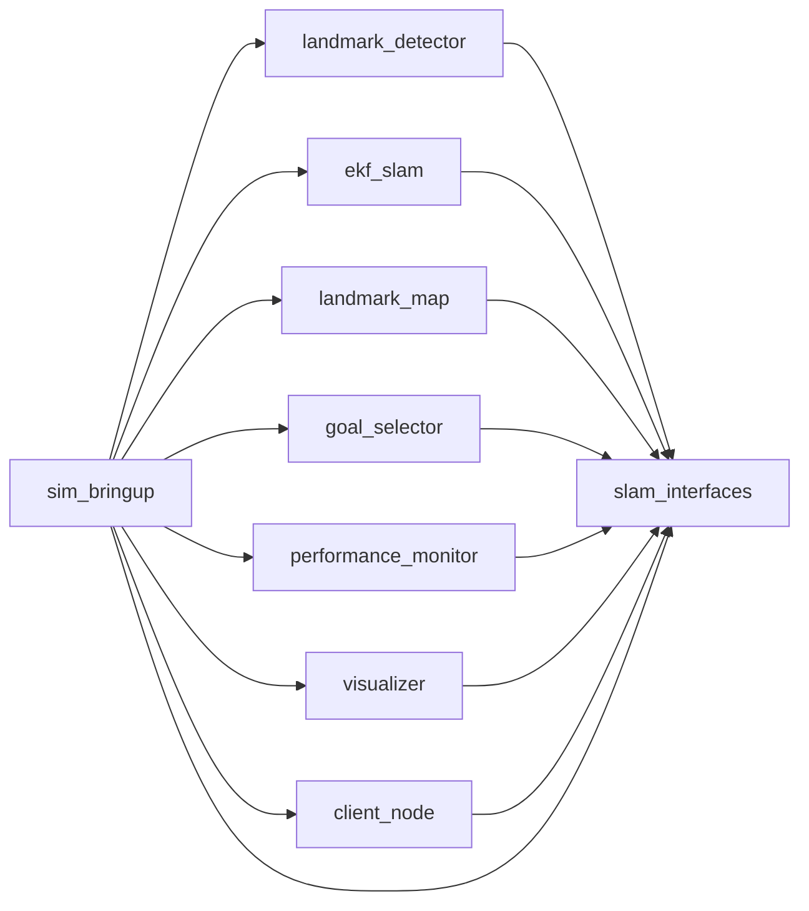

<p align="center">
  <a href="BUILD.md">English</a> | <a href="BUILD.zh-CN.md">简体中文</a>
</p>

# 构建 BEACON

BEACON 就是一个普通的 ROS 2 工作区：`src/` 下九个软件包，一次 `colcon build`，一次 `source`。
本文讲构建本身——每个软件包产出什么、哪些参数值得了解、如何只重建改动过的部分，以及构建失败时
该怎么办。安装 Ubuntu、ROS 2 Humble 与依赖的步骤见 [INSTALL.zh-CN.md](INSTALL.zh-CN.md)。

## 首次构建之前

只有当 ROS 2 与系统库已经在机器上时，工作区才构建得起来。先检查：

```bash
source /opt/ros/humble/setup.bash
ros2 pkg prefix nav2_collision_monitor
gazebo --version
python3 -c 'import numpy, scipy, cv2'
```

若其中任何一条失败，或者连 `ros2` 都找不到，请运行 `./scripts/install_deps.sh` 并阅读
[INSTALL.zh-CN.md](INSTALL.zh-CN.md)。

构建还依赖另外两件事：

* **`PATH` 上的 `python3` 是 3.10。** Humble 以 Python 3.10 为目标，而工作区的软件包会被装进
  构建它们的那个解释器里。若 conda 或虚拟环境遮蔽了系统 `python3`，必须先退出，否则 `ros2 run`
  会用与构建时不同的解释器启动节点。
* **支持符号链接的文件系统。** `--symlink-install` 需要真正的符号链接，请把工作区放在原生
  Linux 文件系统上，例如 `~/ros2_ws`。VirtualBox 共享目录、NTFS 挂载或 WSL 下的 Windows 路径
  都会让构建失败。

## 构建

```bash
cd ~/ros2_ws
source /opt/ros/humble/setup.bash
colcon build --symlink-install
source install/setup.bash
```

每个新 shell 都要在 `colcon build` **之前**执行 `source /opt/ros/humble/setup.bash`：
`colcon` 是通过环境而非硬编码路径来查找 `slam_interfaces` 与 `sim_bringup` 编译所依赖的
ROS 2 软件包。

`colcon build` 必须在工作区根目录执行——也就是包含 `src/` 的目录。它会自动找到所有软件包并按
依赖顺序构建。

构建成功的结尾是：

```
Summary: 9 packages finished [1min 12s]
```

速度快是因为几乎没有编译：`slam_interfaces` 的消息生成是唯一的代码生成步骤，其余七个 Python
软件包以可编辑模式安装。

`build/`、`install/`、`log/` 都生成在工作区根目录。三者都被 gitignore 忽略且可随时丢弃，工作区
之外没有任何东西依赖它们。

## 各个软件包的产出

| 软件包 | 构建类型 | 构建步骤做了什么 |
|---|---|---|
| `slam_interfaces` | `ament_cmake` | 运行 `rosidl_generate_interfaces`，为三个消息、`GoToBlock` 动作与 `StartObstacles` 服务生成 C++ 与 Python 绑定。这是工作区里唯一的真实编译。 |
| `landmark_detector` | `ament_python` | 可编辑安装，外加 `detector_node`、`lifecycle_autostart` 与 `sample_color` 三个 console script。 |
| `ekf_slam` | `ament_python` | 可编辑安装，外加 `slam_node` 脚本与 `config/ekf_params.yaml`。 |
| `landmark_map` | `ament_python` | 可编辑安装，外加 `map_node` 脚本与 `config/map_params.yaml`。 |
| `goal_selector` | `ament_python` | 可编辑安装，外加 `action_server` 脚本与 `config/goal_selector_params.yaml`。 |
| `performance_monitor` | `ament_python` | 可编辑安装，外加 `monitor_node` 脚本。 |
| `visualizer` | `ament_python` | 可编辑安装，外加 `viz_node` 脚本。 |
| `client_node` | `ament_python` | 可编辑安装，外加 `client` 脚本。 |
| `sim_bringup` | `ament_cmake` | 把 `launch/`、`worlds/`、`config/`、`models/` 装到 `share/sim_bringup/`，把六个命令行工具装到 `lib/sim_bringup/`，这样 `ros2 run sim_bringup <tool>.py` 才可用。 |

软件包在运行期需要的任何文件，都必须出现在其 `CMakeLists.txt` 的 `install(...)` 中或
`setup.py` 的 `data_files` 中。没有被安装的文件在构建后并不存在，尽管它在 `src/` 里。

## 为什么要 `--symlink-install`

该选项让非 Python 资源的安装副本——启动文件、世界文件、模型、RViz 配置、参数文件以及
`sim_bringup` 的命令行工具——成为指回 `src/` 的符号链接，而不是拷贝。这样修改世界文件或启动
文件后，下一次 `ros2 launch` 就生效，无需重新构建。Python 软件包本来就是可编辑安装，运行的就是
源码。

不加该选项时这些资源会被拷贝，修改后要等下一次 `colcon build` 才生效。请一直保留这个选项。

## 构建顺序与依赖

`colcon` 从 `package.xml` 的声明推导顺序，所以直接 `colcon build` 永远是正确的。工作区内部的
依赖关系如下：



`sim_bringup` 是唯一会拉进整套栈的软件包，因为它的启动文件要启动每一个节点。`slam_interfaces`
是其余软件包唯一离不开的包。

### 修改接口

改动 `src/slam_interfaces/{msg,srv,action}/` 下的任何内容，都意味着生成的绑定发生了变化，所有
导入它们的软件包都必须重建并重新加载：

```bash
colcon build --symlink-install
source install/setup.bash
```

这种情况下不要只重建 `slam_interfaces`。生成模块的旧副本，正是 `.msg` 文件里"明明存在"的字段
却抛 `ImportError` 或 `AttributeError` 的常见原因。

## 修改后如何重建

| 改动内容 | 命令 |
|---|---|
| 启动文件、世界文件、模型、RViz 配置或参数文件 | 无需操作。`--symlink-install` 已指向源码。 |
| 节点或命令行工具中的 Python 文件 | 无需操作，软件包是可编辑安装。重启节点即可。 |
| `package.xml`（新增依赖、新增导出） | `colcon build --symlink-install` |
| `CMakeLists.txt`、`setup.py`、`entry_points`、新增文件 | `colcon build --symlink-install` |
| `src/slam_interfaces/{msg,srv,action}/` 下的任何内容 | 先 `colcon build --symlink-install`，再 `source install/setup.bash` |

## 只构建一部分

迭代时很有用，因为一次完整构建仍要花大约一分钟。

```bash
# 只构建这个包，前提是它的依赖已经构建过
colcon build --symlink-install --packages-select ekf_slam

# 这个包以及它需要的一切
colcon build --symlink-install --packages-up-to sim_bringup

# 这个包以及所有依赖它的包
colcon build --symlink-install --packages-above slam_interfaces
```

部分构建之后要重新加载工作区。`install/setup.bash` 会被重新生成，并纳入当前存在的部分，所以部分
构建不会破坏工作区其余部分——但从未构建过的软件包自然无法导入，这就是拿不准时 `--packages-up-to`
更安全的原因。

## 值得了解的参数

| 参数 | 作用 |
|---|---|
| `--symlink-install` | 链接资源而非拷贝。始终使用它。 |
| `--packages-select <pkg>` | 只构建这些软件包。 |
| `--packages-up-to <pkg>` | 构建这些软件包及其依赖。 |
| `--packages-above <pkg>` | 构建这些软件包及其依赖者。 |
| `--packages-skip <pkg>` | 从构建中排除某个软件包。 |
| `--parallel-workers N` | 限制同时构建的软件包数量。这里很少需要。 |
| `--continue-on-error` | 第一个包失败后继续，以便一次看到所有失败。 |
| `--event-handlers console_direct+` | 输出原始构建信息，而非过滤后的版本。 |
| `--cmake-args -DCMAKE_BUILD_TYPE=Release` | 优化编译产物。对本工作区无意义：这里只编译消息生成。 |

## 什么时候该清空 `build/` 与 `install/`

三个生成目录能挺过很多情况，但遇到下列少数问题时值得清空：

* 构建报错说 `src/` 中某个文件已不存在，
* `install/` 里有 `src/` 中已经不再有的软件包或版本，
* 工作区是从另一台机器复制来的，或由另一个用户构建的，
* `package.xml` 中的软件包名或依赖发生了变化，
* 构建成功，但节点导入的是旧版本的模块。

```bash
cd ~/ros2_ws
rm -rf build install log
source /opt/ros/humble/setup.bash
colcon build --symlink-install
source install/setup.bash
```

删掉这三个目录永远是安全的——它们被 gitignore 忽略且会重新生成。`log/` 每构建一次就多一个
`build_<timestamp>/` 目录，随时可以单独删除。

如果之前的构建是用 `sudo` 跑的，`install/` 会归 root 所有，下一次构建就报权限错误。应当修正
归属而不是再次提权：

```bash
sudo chown -R "$USER:$USER" build install log
```

## 检查构建结果

```bash
source install/setup.bash
colcon list                 # 九个软件包及其路径
ros2 pkg prefix slam_interfaces
ros2 pkg executables sim_bringup
```

`ros2 pkg executables sim_bringup` 应当列出六个带 `.py` 后缀的工具——`benchmark.py`、
`dynamic_obstacles.py`、`tf_relay.py`、`visibility_map.py`、`world_rules.py` 与
`world_setup.py`。它们由 `install(PROGRAMS ...)` 直接从 `scripts/` 安装，所以文件名就是命令名。
如果列表为空，说明那一步没有执行——请检查 `scripts/` 是否存在，以及构建是否真的完成。

## 运行测试

```bash
source /opt/ros/humble/setup.bash
source install/setup.bash
PYTEST_DISABLE_PLUGIN_AUTOLOAD=1 python3 -m pytest src -q
```

加载 `install/setup.bash` 才让工作区软件包可导入，所以测试要在构建之后跑，而不是之前。
`PYTEST_DISABLE_PLUGIN_AUTOLOAD=1` 会把 `colcon build` 装上的 pytest 插件——
`launch_testing`、`ament_copyright`、`ament_flake8`、`ament_pep257`——挡在本次运行之外，否则它们
会让收集阶段中止。CI 使用的正是这条命令，测试不需要 ROS 图、不需要 Gazebo，也不需要仿真器。
四个测试套件覆盖纯逻辑层：EKF 核心、坐标变换、颜色阈值，以及带碰撞记录的目标状态机。

## 可选：固化构建设置

可以让 `--symlink-install` 成为默认值，这样单跑 `colcon build` 就够了。创建
`~/.colcon/defaults.yaml`：

```yaml
build:
  symlink-install: true
```

同一个文件放在工作区根目录并命名为 `colcon_defaults.yaml`，则只对该工作区生效，并覆盖全局那份。
BEACON 两个文件都不提供，因为它们会改变机器上每次 `colcon` 调用的行为，而文档中到处都显式写了
这个参数。

## 持续集成

[`.github/workflows/ci.yml`](../.github/workflows/ci.yml) 在 `ubuntu-22.04` 上以 ROS 2 Humble
构建并测试工作区。相关任务是：

```bash
source /opt/ros/humble/setup.bash
colcon build --symlink-install
source install/setup.bash
PYTEST_DISABLE_PLUGIN_AUTOLOAD=1 python3 -m pytest src -q
```

所以按本文在本地构建就能复现 CI。另外两个任务分别对 `src/` 与 `.github/scripts/` 跑 `flake8`、
对 `scripts/` 跑 `shellcheck`，以及一个校验所有 `package.xml`、所有 YAML 与 XML 资源和行尾的
元数据检查。

## 构建问题

**`colcon: command not found`。**
安装 `python3-colcon-common-extensions` 并先加载 ROS 2：`source /opt/ros/humble/setup.bash`。

**`Summary: 0 packages finished` 且没有报错。**
`colcon` 不是在 工作区根目录运行的，或者软件包不在 `src/` 里。用 `colcon list` 看看它找到了什么。
如果软件包在别处，传 `--base-paths <dir>`。

**创建符号链接失败，或构建报 `Operation not supported`。**
工作区所在的文件系统不支持符号链接。把它移到原生 Linux 路径，或去掉 `--symlink-install` 并
接受每次改资源后都要重建。

**`Package 'slam_interfaces' not found`，或消息类型无法导入。**
要么 `slam_interfaces` 还没构建，要么这个 shell 没有加载 `install/setup.bash`。
`source /opt/ros/humble/setup.bash` 与 `source install/setup.bash` 都需要，且顺序如此。

**重建时在 `build/slam_interfaces` 内部报 rosidl 或生成器错误。**
生成的代码是旧的。删掉 `build/slam_interfaces` 与 `install/slam_interfaces` 后重建，再重新加载。

**构建成功，但启动文件找不到世界文件、模型或配置文件。**
该文件没有被安装。把它加到软件包 `CMakeLists.txt` 的 `install(...)` 中，或加到 `setup.py` 的
`data_files` 中。留在 `src/` 里的文件对 `ros2 launch` 是不可见的。

**节点报某个已安装依赖的 `ModuleNotFoundError`。**
有 conda 或虚拟环境遮蔽了系统 `python3`，节点跑在一个看不到 ROS 2 软件包的解释器上。退出该环境
并重建，确保 `colcon build` 之前 `which python3` 指向 `/usr/bin/python3`。

**构建在 `install/` 下报权限错误。**
该目录被之前 `sudo colcon build` 变成了 root 所有。见上面的 `chown` 命令。

**构建没有报错，但 Gazebo 或节点启动后机器人不动。**
这是运行时问题而非构建问题；[INSTALL.zh-CN.md](INSTALL.zh-CN.md) 的故障排查一节覆盖了常见原因。

## 相关文档

* [WALKTHROUGH.zh-CN.md](WALKTHROUGH.zh-CN.md) —— 把整条路径走一遍，从 clone 到目标完成。
* [INSTALL.zh-CN.md](INSTALL.zh-CN.md) —— 平台、依赖、手动 `apt` 路线、运行时问题。
* [`../CONTRIBUTING.md`](../CONTRIBUTING.md) —— 项目结构、新增软件包、提交与 pull request 约定。
* [`.github/workflows/ci.yml`](../.github/workflows/ci.yml) —— CI 到底跑了什么。
